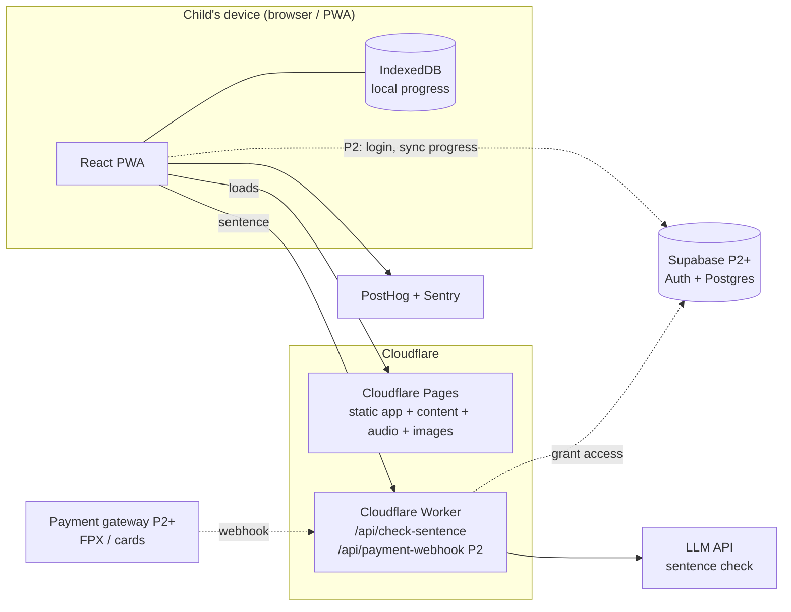
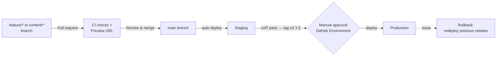
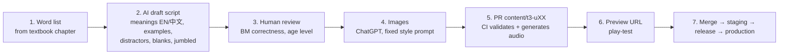

# Jelajah Kata — Product & Technical Plan

*BM vocabulary learning game for KSSR primary school pupils (Tahun 3–6)*
*Version 0.1 · 16 Nov 2026 · Draft for review*

---

## 1. Product summary

| Item | Decision |
|---|---|
| Audience | Children aged 9–12, KSSR Bahasa Melayu |
| Tracks | One track per school year, starting with **Tahun 3** (changed from Tahun 4, 16 Nov 2026); Tahun 4–6 added later |
| Unit of content | **1 textbook chapter = 1 game** (≈ 8–12 words per chapter) |
| Support language | BM content; explanations and instructions in **English or 中文** (switchable) |
| Sentence checking | **AI check** of free-written sentences |
| Images | Generated by Yang with ChatGPT, one consistent style |
| Business model | Own web app; parents (and later tuition centres) pay; **no Roblox** |

### Chapter game flow

| Stage | Name | Goal | Activities |
|---|---|---|---|
| 1 | **Kenali** (Get to know) | Know the meaning | Word cards (picture, audio, meaning EN/中文, word class, example) + Padankan memory-match game |
| 2 | **Uji** (Test) | Recall | Picture→word, word→meaning, Dengar & pilih, Isi tempat kosong, Susun huruf, (seerti/berlawan for higher levels) |
| 3 | **Bina** (Build) | Use correctly | Pilih perkataan, Susun ayat (drag tiles), sentence frames, Tulis sendiri (AI-checked) |
| ★ | **Cabaran Akhir** | Consolidate | Short mixed timed challenge |

Motivation layer: 1–3 stars per stage, collectibles ("Jelajah Malaysia" map), streaks, badges, avatar.

---

## 2. Release roadmap (start simple, test the market)

| Phase | Scope | Users | Exit criteria (go / no-go) |
|---|---|---|---|
| **P1 — Free pilot** | Tahun 3, Tema 1 (Units 1–3), all stages, no login, progress on device, EN/中文 toggle, AI check | Own kids + 5–10 families | Most kids finish a chapter without being pushed; kids return on their own; several parents say "yes" to a stated price |
| **P2 — Paid beta** | All Tahun 3 chapters, parent account, progress view, one-time payment per school year, founding-family price | Early paying families | Paying conversion and retention good enough to justify more content |
| **P3 — Grow** | Tahun 4–6, tuition centre / teacher accounts (class management), full parent dashboard, Ulang Kaji revision mode | Families + centres | — |

The architecture below is designed so P1 is cheap and simple, and P2/P3 are **additions**, not rewrites.

---

## 3. Technology stack

### 3.1 Overview

| Layer | Technology | Why |
|---|---|---|
| Frontend app | **React + TypeScript + Vite** | Mainstream, fast builds, strong typing for content data |
| Installable / offline | **PWA** (vite-plugin-pwa, service worker) | Works on tablets/phones/laptops from a link, no app store, works offline after first load |
| Styling & UI | **Tailwind CSS**, **Framer Motion** (animations), **dnd-kit** (drag-and-drop sentence tiles) | Kid-friendly animations; touch-friendly drag & drop |
| UI translations | **i18next** (EN / 中文 interface strings) | Clean language switching |
| Local progress (P1) | **IndexedDB** (via `idb-keyval` or Dexie) | No backend needed for pilot |
| Content | **JSON files per chapter** in the Git repo, validated with **Zod** schemas | Modular: new chapter = new folder, no code change |
| Audio | **Pre-generated MP3s** from a cloud TTS with Malay (ms-MY) voices (e.g. Azure or Google Cloud TTS), generated at build time | Browser built-in Malay voices are unreliable across devices; pre-generated audio is consistent and works offline |
| Images | ChatGPT-generated PNG → converted to **WebP** (≈ 512×512) at build time | Small files, fast load on mobile data |
| Serverless API | **Cloudflare Workers** | AI-check proxy (hides API key), payment webhooks later; low latency in Malaysia |
| AI sentence check | LLM API (a small, fast model, e.g. Claude Haiku) behind the Worker | Cheap per check; prompt restricted to evaluation only |
| Database & auth (P2+) | **Supabase** (Postgres + Auth + Row Level Security), Singapore region | Parent login, cloud progress sync, entitlements; RLS keeps each family's data isolated |
| Payments (P2+) | Malaysian gateway with FPX + cards — **Billplz**, **ToyyibPay** or **Stripe** (decide in P2) | Parents in Malaysia expect FPX online banking |
| Product analytics | **PostHog** (or Plausible for minimal tracking) | Measures pilot exit criteria: chapter completion, return visits, drop-off points |
| Error monitoring | **Sentry** | Catch crashes on kids' devices |
| Testing | **Vitest** (unit), **Playwright** (end-to-end, incl. mobile viewport), content validation script | Prevents broken chapters reaching kids |
| Source & CI/CD | **GitHub** + **GitHub Actions** | Single place for code, content and pipeline |

### 3.2 Architecture by phase



- **P1:** Pages + one Worker endpoint + IndexedDB + analytics. No database, no login.
- **P2:** add Supabase (auth, progress sync, entitlements) and payment webhook.
- **P3:** add teacher/centre roles and class tables in Supabase; same frontend.

### 3.3 AI sentence check — design

- Flow: app → `POST /api/check-sentence` (Worker) → LLM → structured JSON result → app.
- Request contains only: target word, word class, chapter level, child's sentence. **No names or personal data.**
- Response format (enforced JSON):
  ```json
  { "result": "correct | almost | try_again",
    "uses_target_word": true,
    "tip_en": "Add who is doing the action.",
    "tip_zh": "加上做这个动作的人。",
    "suggested_sentence": "Adik menyapu lantai dapur." }
  ```
- Rules in the prompt: target word must be used with correct meaning; grammar judged at the child's school-year level; forgive small spelling slips; feedback is short, kind and in the selected language.
- Safeguards: rate limit per device (e.g. 20 checks/day), max input length, reject off-topic or inappropriate input with a neutral "Cuba tulis ayat menggunakan perkataan ini" message, log results for quality review.

### 3.4 Content data model (per chapter)

```
content/
  tahun-3/
    track.json                 # list of chapters, order, titles
    unit-01/
      chapter.json             # words, sentences, quiz data
      images/menyapu.webp
      audio/menyapu.mp3
      audio/menyapu-example.mp3
```

```json
{
  "id": "t3-u01",
  "year": 3,
  "unit": 1,
  "title": { "bm": "…", "en": "…", "zh": "…" },
  "words": [
    {
      "word": "menyapu",
      "class": "kata kerja",
      "meaning": { "bm": "membersihkan lantai dengan penyapu", "en": "to sweep", "zh": "扫地" },
      "image": "menyapu.webp",
      "audio": "menyapu.mp3",
      "example": { "bm": "Adik menyapu lantai dapur.", "en": "…", "zh": "…" },
      "synonym": null,
      "antonym": null,
      "blank_sentences": ["Ibu ___ halaman rumah setiap pagi."],
      "jumbled_sentence": ["Kami", "menyapu", "kelas", "selepas", "sekolah"],
      "distractors": ["mengelap", "membasuh", "menyiram"]
    }
  ]
}
```

Example sentences and images are **original** (not copied from the textbook) to avoid copyright issues when selling.

### 3.5 Data stored (P2+) — minimal by design

| Table | Key fields |
|---|---|
| `parents` | id, email, preferred language, created_at |
| `children` | id, parent_id, nickname (no full name / school), year track |
| `entitlements` | parent_id, track (e.g. `tahun-3`), source (payment ref), valid_until |
| `progress` | child_id, chapter_id, stage, stars, updated_at |
| `word_stats` | child_id, word_id, seen, correct, wrong, mastered |
| `sentences` | child_id, word_id, sentence, ai_result, created_at |

Privacy: collect the minimum; parental consent at sign-up; review current Malaysian **PDPA** obligations before P2 launch (children's data, breach handling). *Not legal advice.*

---

## 4. Where it runs when we go live

| Component | Platform | Notes |
|---|---|---|
| Web app, content, images, audio | **Cloudflare Pages** | Global CDN with Kuala Lumpur edge; instant rollbacks; free tier covers pilot |
| API (AI check, webhooks) | **Cloudflare Workers** | Same account as Pages; secrets stored as Worker secrets |
| Database & auth (P2+) | **Supabase**, Singapore region | Closest region to Malaysia |
| Domain | `.my` or `.com` domain (e.g. *jelajahkata.my*), DNS on Cloudflare | `app.` for production, `staging.` for staging |
| Analytics / errors | PostHog Cloud, Sentry | Free tiers sufficient for pilot |
| Distribution | Link shared to parents → "Add to Home Screen" (PWA) | Optional later: wrap with Capacitor for Play Store / App Store if parents ask for it (store fees then apply) |

Pilot running costs should sit mostly within free tiers; the main variable cost is AI checks and TTS generation, both small at pilot scale and capped by rate limits. Confirm current pricing before P2.

---

## 5. Pipeline: development → staging → production

### 5.1 Environments

| Environment | URL | Branch / trigger | Data & services | Who uses it |
|---|---|---|---|---|
| **Local** | `localhost` | Any working branch | Mock AI (or dev key with low limit), local Supabase via CLI (P2+), payment sandbox | Developer |
| **Preview** | Auto URL per PR (Cloudflare Pages preview) | Every pull request | Staging Worker + staging Supabase | Developer, content reviewer (check new chapter before merge) |
| **Staging** | `staging.<domain>` | Merge to `main` (auto) | Separate Supabase project, payment **sandbox**, separate AI key with low limits | Yang, reviewers, a few test families for UAT |
| **Production** | `app.<domain>` | Git tag / GitHub Release `vX.Y.Z` + **manual approval** | Production Supabase, live payments, production AI key | Real families |

Rule: **each environment has its own secrets, database and API keys.** Nothing in staging can touch production data.

### 5.2 Branching & release flow (trunk-based)



1. Work happens on short-lived branches: `feature/…` for code, `content/t3-u03` for chapters.
2. Open a PR → CI runs → Cloudflare creates a **preview URL** to play the change.
3. Merge to `main` → auto-deploy to **staging**.
4. Test on staging (checklist in 5.5) on a real phone and tablet.
5. Create release tag `vX.Y.Z` → GitHub Actions waits for **manual approval** → deploys to **production**.
6. Rollback: redeploy the previous release in Cloudflare Pages (one click) or re-run the previous tag.

### 5.3 CI checks (GitHub Actions, on every PR)

| Check | Tool | Blocks merge if… |
|---|---|---|
| Lint & format | ESLint, Prettier | Style or obvious bug issues |
| Type check | `tsc --noEmit` | Type errors |
| Unit tests | Vitest | Game logic broken (scoring, spaced repetition, stars) |
| **Content validation** | Custom script + Zod | Missing fields, missing EN/中文 meaning, image or audio file missing, jumbled sentence doesn't match a valid sentence, duplicate words |
| Build | Vite build | App doesn't compile |
| End-to-end tests | Playwright (desktop + mobile viewport) | Can't complete Chapter 1 flow from start to Cabaran Akhir |
| Bundle size | size-limit | App grows beyond budget (protects kids on slow mobile data) |

### 5.4 Deploy jobs

| Job | Trigger | Steps |
|---|---|---|
| `deploy-staging` | Push to `main` | Build → generate missing TTS audio → optimise images → deploy Pages (staging) → deploy Worker (staging) → run DB migrations on staging (P2+) → smoke test |
| `deploy-production` | Tag `v*` + approval | Same build artefact → deploy Pages (prod) → deploy Worker (prod) → DB migrations (prod, P2+) → smoke test → notify (e.g. Telegram/email) |

Database changes (P2+) are versioned migration files (Supabase CLI), always applied to staging first.

### 5.5 Release checklist (staging UAT)

- [ ] Play each new/changed chapter end-to-end on phone and tablet
- [ ] Switch EN ↔ 中文 — all text translated
- [ ] Audio plays for every word and example
- [ ] AI check returns sensible feedback for 5 good and 5 bad sample sentences
- [ ] Works offline after first load (airplane-mode test)
- [ ] (P2+) Sign-up, login, payment in sandbox, access unlocked after payment
- [ ] No new errors in Sentry (staging)

---

## 6. Content pipeline (per chapter)

Content changes far more often than code, so it has its own pipeline that feeds into the same CI/CD.



| Step | Owner | Tool / output |
|---|---|---|
| 1. Word list | Yang | Typed list or textbook photo → `words.txt` |
| 2. AI draft | Script | Generates `chapter.json` draft |
| 3. Review | Yang (ideally plus a BM teacher) | Corrected `chapter.json` |
| 4. Images | Yang | ChatGPT prompt: *"Simple flat cartoon illustration of [meaning], bright colours, white background, child-friendly, no text, square 1:1, Malaysian setting"* → `images/<word>.png` |
| 5. Build | CI | PNG→WebP, TTS audio, schema validation |
| 6. Play-test | Yang / kids | Preview URL |
| 7. Publish | Release flow | Same as code (5.2) |

Target effort once the pipeline is running: about **1–2 hours per chapter**, mostly review and images.

---

## 7. Repository structure

```
jelajah-kata/
├─ apps/web/                 # React PWA
│  ├─ src/
│  │  ├─ stages/             # Kenali, Uji, Bina, CabaranAkhir
│  │  ├─ games/              # Padankan, SusunAyat, SusunHuruf, …
│  │  ├─ engine/             # scoring, stars, spaced repetition
│  │  ├─ i18n/               # en.json, zh.json
│  │  └─ storage/            # IndexedDB (P1) / Supabase sync (P2)
│  └─ tests/                 # Vitest + Playwright
├─ workers/api/              # Cloudflare Worker (AI check, webhooks)
├─ content/tahun-3/…         # chapter folders (see 3.4)
├─ scripts/                  # draft-chapter, validate-content, gen-audio, optimise-images
├─ supabase/migrations/      # P2+
└─ .github/workflows/        # ci.yml, deploy-staging.yml, deploy-production.yml
```

---

## 8. Build plan for P1 (pilot)

| # | Work item | Output |
|---|---|---|
| 1 | Repo, CI, Cloudflare Pages + staging/production set-up | Pipeline live with "hello world" |
| 2 | Content schema + validation script + Tahun 3 Units 1–3 content | First real chapter |
| 3 | Stage 1 Kenali + Padankan | Learn flow |
| 4 | Stage 2 Uji (question types + spaced repetition) | Quiz flow |
| 5 | Stage 3 Bina + AI-check Worker | Sentence flow |
| 6 | Cabaran Akhir, stars, simple collectibles, sounds | Fun layer (light) |
| 7 | EN/中文 toggle, PWA offline, analytics events | Pilot-ready |
| 8 | Units 2–3 via content pipeline | 2–3 chapters |
| 9 | Staging UAT → production release → share with pilot families | Pilot running |

---

## 9. Open items

1. ~~Tahun 4 unit list~~ Tahun 3 Tema 1 photos received; confirm word lists for Units 1–3
2. Default interface language (EN or 中文)
3. Domain name
4. Pilot price question to ask parents (RM amount)
5. Payment gateway choice (decide at start of P2)
6. Whether a BM teacher can review content
